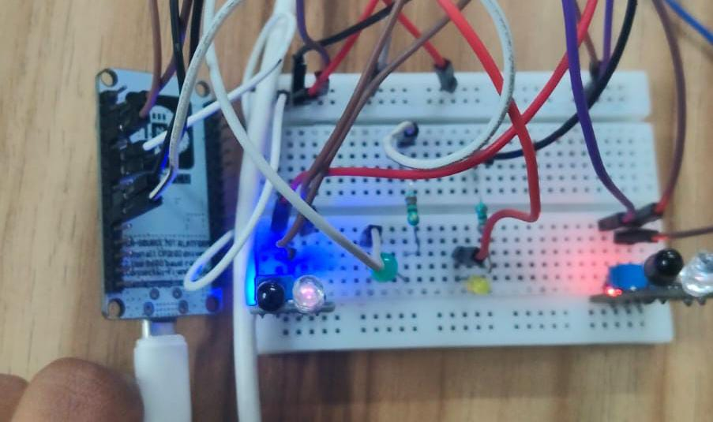
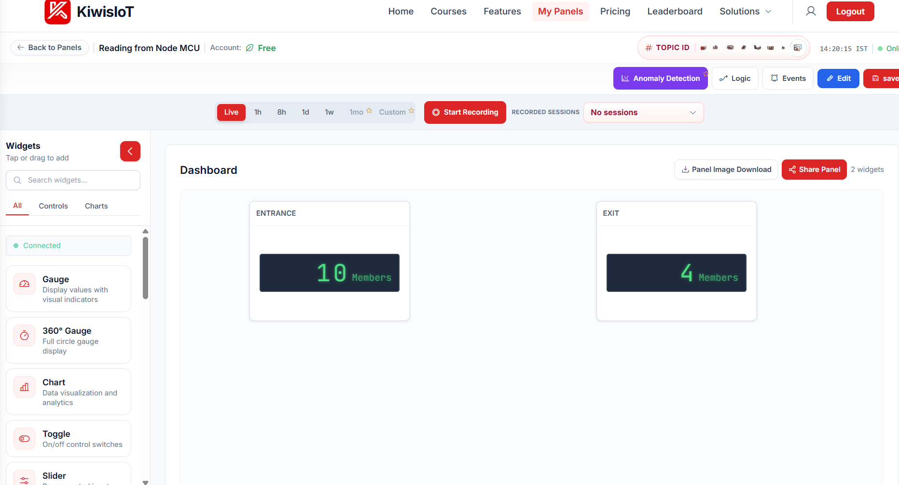

# Live-People-Counter-with-KiwisIoT-Panel
# KiwisIoT Live Visitor Monitoring Platform
# Project Description
An IoT-based visitor monitoring system using ESP8266 and IR sensors to track the number of people entering and exiting a room. The KiwisIoT platform displays the real-time people count, while yellow and green LEDs indicate entrance and exit activity.
# Components Required
- NodeMCU ESP8266
- 2 IR Sensors
- Yellow LED
- Green LED
- Resistors
- Breadboard
- Jumper Wires
# Software & Platform
- Arduino IDE
- KiwisIoT Platform
- Embedded C/C++
# Working Principle
1. The entrance IR sensor detects a person entering and increases the count.
2. The yellow LED blinks to indicate entry.
3. The exit IR sensor detects a person leaving and decreases the count.
4. The green LED blinks to indicate exit.
5. The updated people count is sent to the KiwisIoT platform.
6. The platform displays the live number of people inside.
# Project Images

# Source Code
[View Source Code](enterexit.ino)
# Applications
- Smart classrooms
- Offices
- Libraries
- Shopping centres
- Visitor monitoring systems
Platform

KiwisIoT
